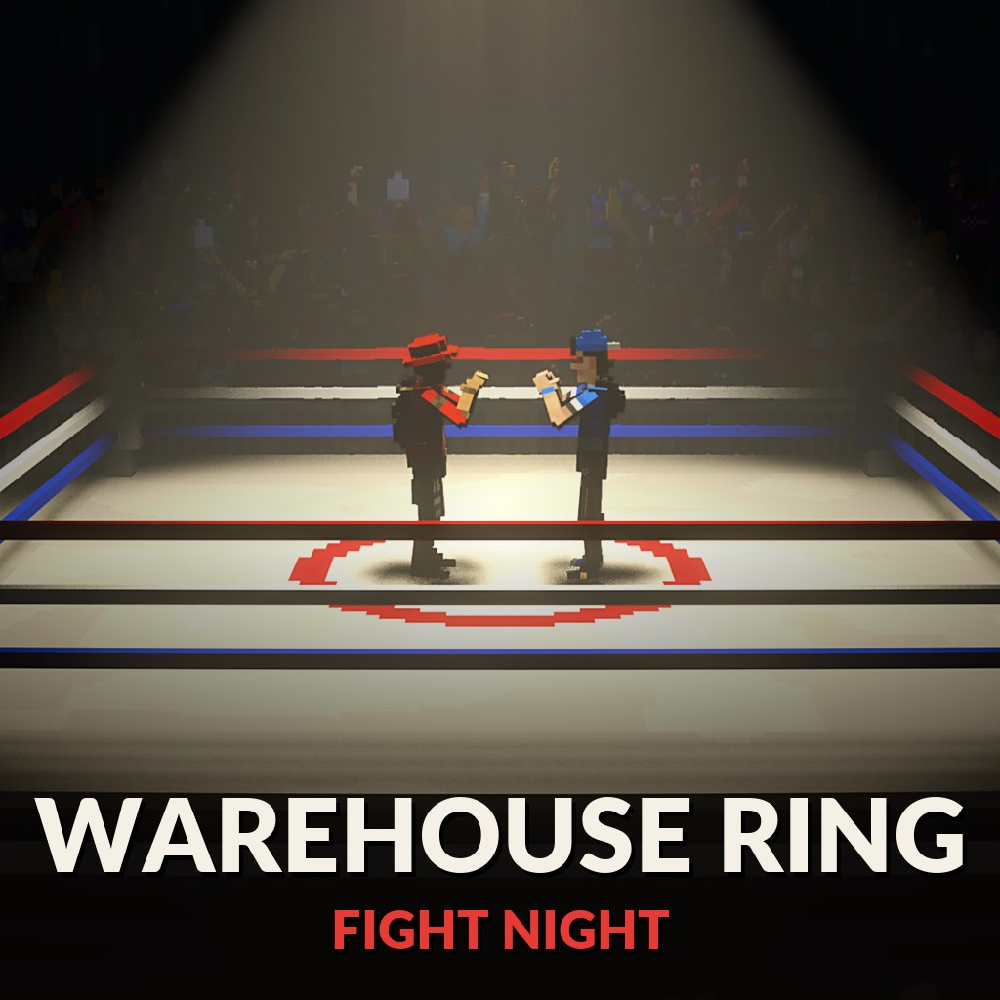

# Warehouse Ring - fight night

On the Steam Workshop: [Warehouse Ring](https://steamcommunity.com/sharedfiles/filedetails/?id=3833371641)

An underground boxing night in a dark warehouse: a ring under a single spotlight and a few hundred fans packed on the floor and the bleachers around it. The crowd gets louder and wilder with every punch landed in the ring - combos and knockouts send them through the roof - and goes quiet when nothing is happening.

join my discord community to post bug reports and/or suggestions!
https://discord.gg/gNpRewdkxf

## Getting into the ring
- Walk into the edge of the ring and keep pushing forward: you pull yourself up onto the apron.
- Push on into the ropes and you vault over them onto the canvas (and back out the same way).
- Hold crouch to let go.

## Fighting
For bare-knuckle fights turn on the [Combat System](https://steamcommunity.com/sharedfiles/filedetails/?id=3822172014) mod (Global mods). Play it with the [Brawl](https://steamcommunity.com/sharedfiles/filedetails/?id=3833372098) game mode for team rounds with knockdowns: the ring is its fight area, and the crowd reacts to every hit.

## Multiplayer
Made for fighting with friends. Everyone sees and hears the crowd.

## Install

Subscribe on the [Steam Workshop](https://steamcommunity.com/sharedfiles/filedetails/?id=3833371641), or clone this repository into
`Documents/Teardown/mods/warehouse ring`. Play it from the **Mod manager** (Local files), or host it in multiplayer.

## Credits

Made by AgeOfAlgorithms and Claude (Anthropic). MIT licence.
